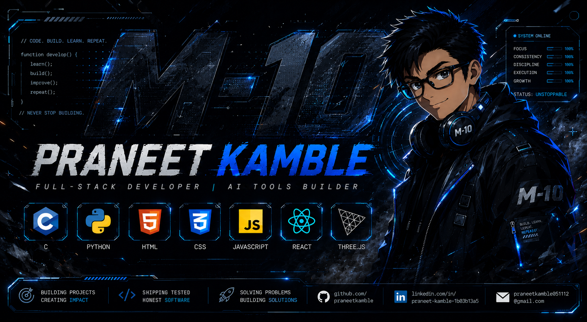
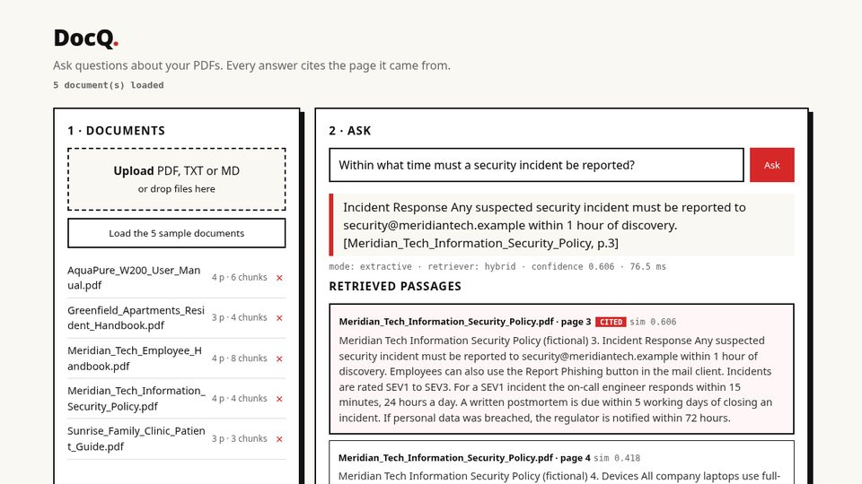
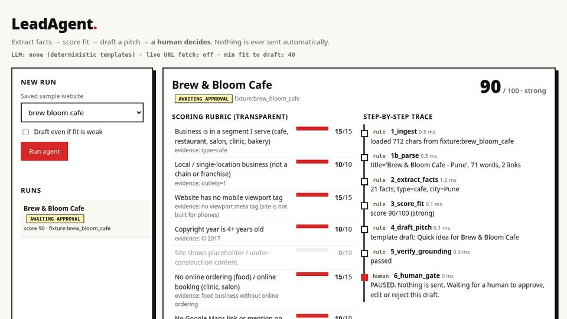
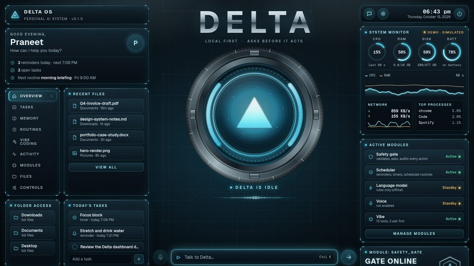
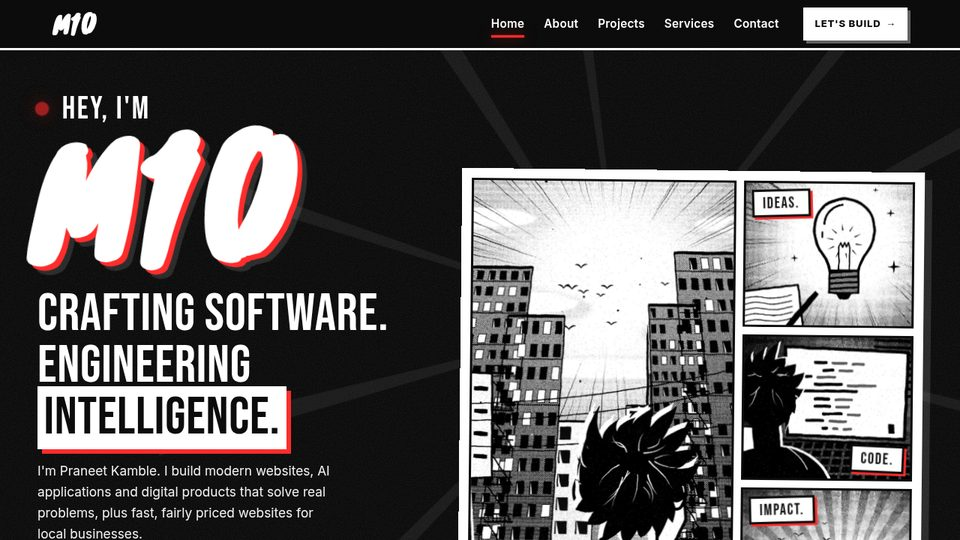
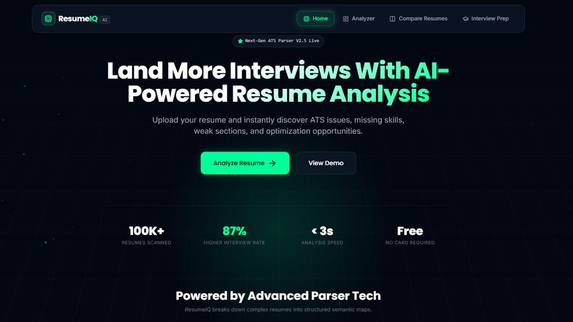
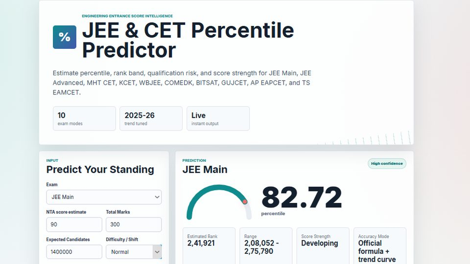

<h1 align="center">👋 Hi, I'm Praneet Kamble</h1>

<h3 align="center">
Full-stack Developer • AI Tools Builder • Engineering Student
</h3>

<p align="center">

</p>

<p align="center">
<a href="https://m-10-nu.vercel.app"></a>
<a href="mailto:praneetkamble051112@gmail.com"></a>
<a href="https://wa.me/917249364351"></a>
<a href="https://www.linkedin.com/in/praneet-kamble-1b03b13a5/"></a>
</p>

<p align="center">
<b>Quick links</b> &nbsp;·&nbsp;
<a href="https://m-10-nu.vercel.app">Portfolio</a> &nbsp;·&nbsp;
<a href="https://github.com/praneetkamble?tab=repositories">GitHub repos</a> &nbsp;·&nbsp;
<a href="mailto:praneetkamble051112@gmail.com">Email</a> &nbsp;·&nbsp;
<a href="https://wa.me/917249364351">WhatsApp</a>
</p>

---

# 🚀 About Me

```yaml
Name: Praneet Kamble

Role:
  - Full-stack Developer (React, Node.js, Python)
  - Engineering Student, near Mumbai

Building:
  - AI and RAG tools that cite their sources
  - Windows automation with real safety checks

Interests:
  - AI
  - Backend Development
  - Frontend Development
  - Linux

Mission:
  Build impactful products and ship software that is tested and honest.
```

---

# 🧰 What I Do

* 🌐 **Full-stack web apps:** React front ends with Node.js and Python back ends.
* 🧠 **AI and RAG tools:** retrieval with citations, agents with human approval.
* ⚙️ **Automation and Windows tooling:** PC assistants and scripts with safety gates.

---

# 🛠 Tech Stack

<p align="center">

</p>

---

# 🚀 Featured Projects

<table>
<tr>

<td width="50%" valign="top">

<h3>🔎 DocQ</h3>

<a href="https://github.com/praneetkamble/docq"></a>

RAG over your own documents. Every answer cites the page it came from, so you can check it.

<b>Highlights:</b> 92% top-1 and 100% top-5 on a 25-question test set<br>
<b>Stack:</b> Python · FastAPI · BM25 + vectors<br>
<a href="https://github.com/praneetkamble/docq">View repo →</a> &nbsp;

</td>

<td width="50%" valign="top">

<h3>🤖 LeadAgent</h3>

<a href="https://github.com/praneetkamble/leadagent"></a>

Lead-qualification agent that drafts outreach and waits for human approval. Approving sends nothing.

<b>Highlights:</b> Human-in-the-loop by design · 19 automated tests<br>
<b>Stack:</b> Python · FastAPI · Agent loop with step trace<br>
<a href="https://github.com/praneetkamble/leadagent">View repo →</a> &nbsp;

</td>

</tr>
<tr>

<td width="50%" valign="top">

<h3>🖥 Delta</h3>

<a href="https://github.com/praneetkamble/delta"></a>

Safety-first Windows PC assistant with a HUD dashboard and a built-in Vibe Coding space.

<b>Highlights:</b> 693 automated tests · one safety gate for every action<br>
<b>Stack:</b> Python · FastAPI · pywin32<br>
<a href="https://github.com/praneetkamble/delta">View repo →</a> &nbsp;

</td>

<td width="50%" valign="top">

<h3>🎨 M10 Portfolio</h3>

<a href="https://github.com/praneetkamble/m10-portfolio"></a>

Manga-style developer portfolio that showcases all of my projects, live and mobile-friendly.

<b>Highlights:</b> Live and deployed · responsive on mobile<br>
<b>Stack:</b> HTML · CSS · JavaScript<br>
<a href="https://github.com/praneetkamble/m10-portfolio">View repo →</a> · <a href="https://m-10-nu.vercel.app">Live site →</a>

</td>

</tr>
<tr>

<td width="50%" valign="top">

<h3>📄 ResumeIQ</h3>

<a href="https://github.com/praneetkamble/resume_analyser"></a>

AI resume analyzer and interview prep coach with ATS scoring and STAR-style practice.

<b>Highlights:</b> Parses PDF, DOCX and TXT · keyword-gap analysis<br>
<b>Stack:</b> React · TypeScript · Python (FastAPI)<br>
<a href="https://github.com/praneetkamble/resume_analyser">View repo →</a> &nbsp;

</td>

<td width="50%" valign="top">

<h3>📊 Percentile Predictor</h3>

<a href="https://github.com/praneetkamble/percentile-predictor"></a>

Percentile, rank band and admission-risk estimates for JEE, MHT CET and other entrance exams.

<b>Highlights:</b> 10 exam modes · clear that results are estimates<br>
<b>Stack:</b> JavaScript · HTML · CSS<br>
<a href="https://github.com/praneetkamble/percentile-predictor">View repo →</a> &nbsp;

</td>

</tr>
</table>

---

# 📊 GitHub Analytics

<p align="center">

</p>

<p align="center">


</p>

<p align="center">

</p>

---

# 🎯 Current Focus

* 🖥 **Delta:** real Windows hardware controls and voice
* 🔎 **Retrieval and agent evaluation:** measuring what actually works
* 🌐 **Full-stack development:** React, Node.js, Python
* 💼 **Open to freelance** web and AI projects

---

# 🌐 Connect With Me

<p align="center">

<a href="https://github.com/praneetkamble">

</a>

<a href="https://www.linkedin.com/in/praneet-kamble-1b03b13a5/">

</a>

<a href="mailto:praneetkamble051112@gmail.com">

</a>

<a href="https://wa.me/917249364351">

</a>

</p>

<p align="center">
<a href="https://m-10-nu.vercel.app">Portfolio</a> &nbsp;·&nbsp;
<a href="https://github.com/praneetkamble?tab=repositories">GitHub repos</a> &nbsp;·&nbsp;
<a href="mailto:praneetkamble051112@gmail.com">Email</a> &nbsp;·&nbsp;
<a href="https://wa.me/917249364351">WhatsApp</a>
</p>

---

<p align="center">

</p>

<h3 align="center">
⚡ BUILD • LEARN • CREATE • REPEAT ⚡
</h3>

<p align="center">
Turning Ideas Into Reality 🚀
</p>
